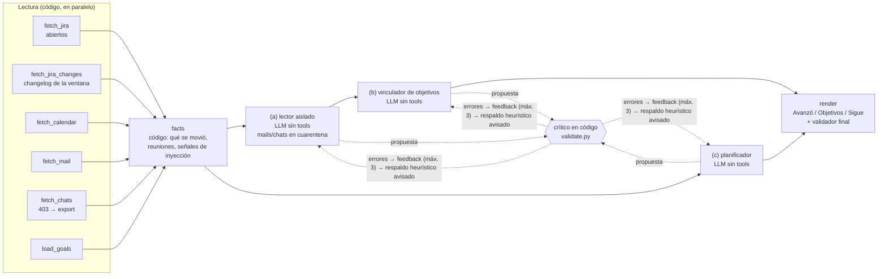

# daily-digest

Asistente que cruza **Jira, calendario de Outlook, mails y chats de Teams reales** (por API, sin copiar nada a mano) y arma cada mañana un informe en tres secciones:

1. **Avanzó**: qué se movió ayer (transiciones y comentarios de Jira, reuniones, mails y chats).
2. **Ayudó a objetivos**: cómo ese avance aporta a cada objetivo.
3. **Sigue**: el plan priorizado de hoy, en los huecos libres del calendario.

**Cada afirmación cita ids reales** (`jira:AM-7`, `cal:…`, `mail:…`, `chat:…`, `goal:N`) y un crítico en código rechaza lo que no se pueda verificar.

Hecho para el AI Day de Flock IT, challenge *Reporte diario cruzando sistemas reales*, nivel Builder.

## Arquitectura



- **Fuentes reales:** Jira Cloud REST (issues y changelog) y Microsoft 365, por Graph (`/me/messages`, `/me/chats`, `/me/calendarView`) o, si no hay token, por el **conector Microsoft 365** vía `claude -p` (ver [ADR-0004](docs/adr/0004-token-graph-corta-vida-y-plan-b-mcp.md)).
- **El LLM propone, el código decide:** cada agente pasa por su crítico. Las citas tienen que existir, toda afirmación cita algo, todo `goal:` citado existe, no hay URLs ni enlaces, y el plan respeta horario y reuniones y no queda vacío si hay trabajo. Si el modelo no converge en 3 intentos, se usa un respaldo heurístico **y el informe lo avisa**.
- **Multiagente con criterio** ([ADR-0002](docs/adr/0002-codigo-vs-llm.md)): traer datos es código. Hay tres agentes LLM, cada uno con un motivo, y el crítico no es un LLM.
- **Seguridad** ([ADR-0003](docs/adr/0003-cuarentena-de-entrada-no-confiable.md)):
  - Sin canal de salida.
  - Mails y chats en cuarentena: solo los ve el lector, sin tools, con delimitadores escapados.
  - Los demás agentes nunca ven texto crudo.
  - Un mail malicioso de ejemplo (`fixtures/mails.json`) se detecta, se avisa y no se obedece, ni siquiera con un modelo "comprometido".
- **Observabilidad:** un JSONL por corrida en `_local-only/traces/`, con un span por nodo y por llamada al modelo (`invoke_agent`, `chat`, `execute_tool`, `gen_ai.usage.input_tokens`, latencia y costo). No guarda contenidos de mensajes.

## Cuándo NO usa IA (decisiones)

| Paso | ¿IA? | Por qué |
|---|---|---|
| Traer tickets, cambios, reuniones, mails y chats | No | Son consultas determinísticas; un LLM solo agregaría riesgo de inventar datos. |
| "Qué se movió en Jira" | No | El changelog ya es estructurado (`To Do → In Progress`). |
| Calcular la ventana "ayer" y los huecos libres | No | Es aritmética de fechas. |
| Detectar posibles inyecciones | No (regex) | Es una señal para el humano, no una defensa: la defensa es la arquitectura. |
| Validar el informe | No | Las reglas son exactas (la cita existe, el objetivo existe, no hay URLs, no hay superposiciones). Un LLM juez sería más caro y menos confiable. |
| Resumir mails y chats | **Sí** (aislado) | Es lenguaje natural de terceros. |
| Vincular avance ↔ objetivos | **Sí** | Los objetivos están en prosa; relacionarlos requiere criterio. |
| Priorizar el día | **Sí** | Pesar prioridad, vencimiento, estado y antigüedad con criterio. |

## Uso

```bash
python -m venv .venv && .venv\Scripts\activate
pip install -e ".[dev]"
daily-digest --offline --no-llm        # demo sin credenciales (fixtures ficticios)
daily-digest --offline                 # fixtures + modelo real (API o `claude -p`)
pytest                                 # tests y golden dataset offline
python scripts/run_evals.py            # informe de evals (LLM simulado determinístico)
python scripts/validar.py              # harness: estructura, secretos, tests y evals
sh scripts/instalar-hooks.sh           # hook pre-push con el mismo validador
```

**Con datos reales:** copiar `.env.example` a `.env` y completar Jira. Para Microsoft 365 hay dos opciones:
- `GRAPH_ACCESS_TOKEN` (Graph Explorer, ~1 h).
- Sin token: el conector Microsoft 365 de Claude Code, con `claude` logueado y el conector autenticado en `/mcp`.

Para el modelo: `ANTHROPIC_API_KEY`, o sin clave, `claude -p` con la cuenta logueada. Después, `daily-digest`.

Opciones:
- `--desde/--hasta`: período a resumir. Por defecto, el día laboral anterior; el lunes mira el viernes.
- `--fuentes-m365 graph|mcp`
- `--llm anthropic|claude-cli`

El informe se guarda en `_local-only/digests/` y la traza en `_local-only/traces/`; nunca van a git.

### Planner web (calendario + tareas)

```bash
daily-digest-web        # http://127.0.0.1:8765
```

- **Calendario del día:** reuniones y bloques planificados. Los eventos de todo el día aparecen arriba y no bloquean.
- **Tareas:** Arrastrado, Plan de hoy, Backlog y Hechas.
- **Detalle de cada tarea:** estado, por qué está en el plan, qué se movió en el período, a qué objetivo aporta, citas y link a Jira.
- **Botones:** "Generar demo" (instantáneo), "Actualizar con mis datos" y "Actualizar con modelo".

**"Marcar como hecha"** impacta en local:
- la tarea pasa a *Hechas* en el informe;
- se guarda en la memoria (`_local-only/digest.db`);
- la próxima corrida no la planifica ni la arrastra.

**No escribe en Jira** ([ADR-0003](docs/adr/0003-cuarentena-de-entrada-no-confiable.md)): el ticket lo movés vos desde el link.

Seguridad del servidor local:
- escucha solo en `127.0.0.1` y rechaza otros `Host` (protege contra DNS rebinding);
- cada escritura exige un token por proceso (protege contra CSRF);
- el texto siempre se pinta como texto, nunca como HTML (lo verifica un test).

**Demo pública (Vercel):** `web/` es un sitio estático que, sin servidor, carga `web/demo.json`, con datos ficticios generados por `python scripts/export_demo.py`. Las interacciones quedan en el navegador. Para desplegar, importar el repo en Vercel; `vercel.json` ya apunta a `web/`. **Los datos reales nunca se publican.**

### Desde Claude Code (servidor MCP propio)

```bash
pip install -e ".[mcp]"
claude mcp add daily-digest -- <ruta-al-repo>/.venv/Scripts/python.exe -m daily_digest.mcp_server
```

Tools:
- `list_digests` y `get_digest`: leen los digests guardados.
- `run_digest`: por defecto corre la demo offline; para leer tus fuentes hay que pedir `real=True`.

Las respuestas se marcan como datos, no instrucciones ([ADR-0005](docs/adr/0005-mcp-propio-para-el-digest.md)).

### Memoria entre días
Cada corrida real guarda el plan del día en `_local-only/digest.db` (SQLite: solo ticket, horario y motivo). Al día siguiente, lo planificado que sigue abierto y no tuvo movimiento en Jira aparece como **Arrastrado** y el planificador lo prioriza.

Cómo se lee el informe:
- Te habla a vos ("Pediste…", "Te escribió…"). El dueño de la casilla sale de `DIGEST_OWNER` o de Jira.
- "Avanzó" se agrupa por objetivo usando los vínculos validados.
- Un evento que cubre toda la jornada (un "AI Day" de 9 a 18, vacaciones) se muestra pero no bloquea el plan; con `DIGEST_ALLDAY_BLOQUEA=1`, sí bloquea.

## Evals

Golden dataset en [`evals/golden/`](evals/golden/): **49 casos**, grader 100 % código y LLM simulado determinístico que puede programarse para fallar o para obedecer una inyección.

| Categoría | Casos | Qué cubre |
|---|---|---|
| Regresión | 9 | día normal, sin LLM, vencido primero, lunes → viernes, ventana explícita, ticket cerrado citable, segunda persona (modelo y heurístico), "Avanzó" agrupado por objetivo |
| Bordes | 10 | sin reuniones, sin prioridad, sin tickets, sin mails/chats, mail vacío, día sin movimientos, objetivos sin id o vacíos, día sin huecos, evento de todo el día |
| Memoria | 2 | arrastra lo planificado sin movimiento; no arrastra lo cerrado ni lo inexistente |
| Fuentes degradadas | 4 | chats con 403 → export, mails caídos, Jira caído, calendario bloqueado |
| Crítico | 15 | por agente: cita inventada, sin cita, fuera de alcance, mención inline falsa, horario, reunión, JSON inválido, ítems que no son objetos, plan vacío, objetivo inexistente, vínculo sin evidencia, no converge |
| Seguridad | 9 | inyección detectada, modelo obediente, cierre de delimitador, cuarentena (vinculador/planificador no ven crudo, tampoco tras el respaldo), inyección en chat y en ticket, enlace markdown, `` y `![a][r]` |

Resultado (09/10/2026): **pass@1 = 100 % (49/49) offline** y 120 tests en verde. Prueba de mutación: romper cada defensa (aceptar URLs, no escapar delimitadores, filtrar texto crudo al vinculador, no verificar citas) pone al menos un caso en rojo.

**Corrida real de punta a punta** (Jira REST + conector M365 + `claude -p`): validador final con **0 errores**, los tres agentes convergieron en el 1.er intento, ~USD 0,74 y ~1,5 min. El plan salió vacío y era correcto: ese día un bloque de 09 a 18 h no dejaba huecos. Igual mostró que el crítico no tenía regla para planes vacíos, y ahora la tiene.

## Límites conocidos

- **Graph Explorer requiere aprobación de un administrador** en el tenant corporativo. Por eso mails, calendario y chats reales van hoy por el conector M365 (plan B), y `GRAPH_ACCESS_TOKEN` queda como camino directo cuando exista.
- **Costo del plan B:** el conector se consulta con una llamada agéntica por fuente. Medido: USD 0,74 a 1,2 *equivalente API* y ~1,5 a 2 min por corrida (casi todo en chats).
  - Con `claude -p` y una suscripción de Claude (Pro/Team) no se cobra por token: consume cupo del plan. Los subprocess nunca reciben `ANTHROPIC_API_KEY`, así que no pueden facturar a una cuenta de API por accidente.
  - Con Graph, la lectura no usa el modelo.
- **Datos del plan B extraídos por un LLM:** el código valida esquema, ids y ventana, pero no puede verificar que el conector no omita un mail. Con Graph la lectura es determinística.
- **Paginación:** cada fuente trae como máximo 50 ítems (Jira, Graph y el conector). Un día con más movimientos queda truncado.
- **CI:** las actions están ancladas por tag (`@v4`, `@v5`) y no por SHA; mitigado con `permissions: contents: read` y sin secretos.
- **Token de Graph de corta vida** (~1 h): sirve para la demo. El uso diario desatendido necesita una app registrada con refresh token.
- **Chats:** si `Chat.Read` responde 403, se usa `_local-only/chats-export.json` y el informe lo avisa.
- **Objetivos:** se leen de `_local-only/goals.md`. El sprint activo no tiene Sprint Goal ni épicas, así que todavía son provisorios.
- **Respaldos heurísticos:** son más pobres en redacción y en vínculos (coincidencia de palabras).
- **Inyección:** la detección por regex es incompleta y solo sirve de aviso. La defensa es que no hay canal de salida y que todo pasa por el validador ([ADR-0003](docs/adr/0003-cuarentena-de-entrada-no-confiable.md)).
- **Datos de ejemplo:** todo informe de ejemplo de este repo sale de `fixtures/` ficticios y lo dice en el encabezado.

## Documentación
[`docs/specs/reporte-diario.md`](docs/specs/reporte-diario.md) (spec y plan) · [`docs/adr/`](docs/adr/) (decisiones) · [`docs/harness.md`](docs/harness.md) (validación) · [`docs/plan.md`](docs/plan.md) (roadmap: skill de Claude Code, entrega).
